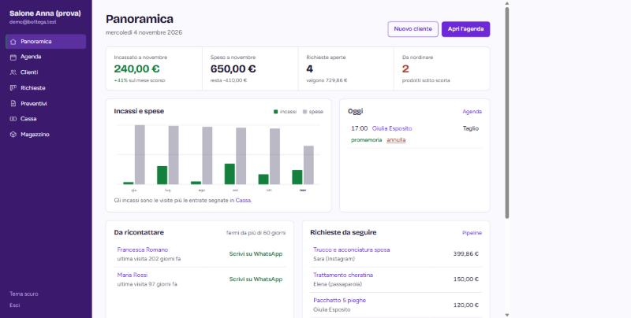
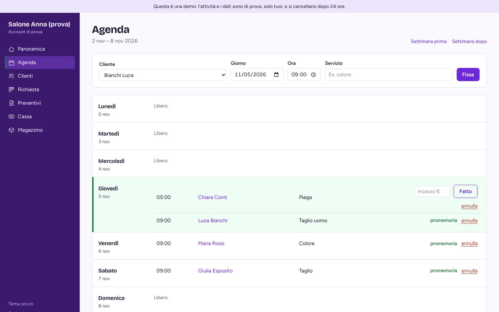

# Bottega

A small CRM for hairdressers, beauticians, gyms, shops and B&Bs that still
keep track of their customers on paper or in WhatsApp chats.

The goal is simple: help the owner notice when a regular customer stops
coming, and make it easy to get back in touch.

Bottega is a learning project, built step by step.





## What it does

- **Accounts per business.** Each owner registers their business and only
  ever sees their own data.
- **Customers.** Records with phone, email, birthday and notes. The list has
  live search and can be sorted by name, last visit or loyalty.
- **Visits.** Date, amount and what was done, added without reloading the page.
- **Agenda.** A weekly view of appointments. Upcoming appointments have a
  WhatsApp reminder link with a ready-made message that says when (today,
  tomorrow or the date), at what time and for which treatment. When an
  appointment is over, you type what the customer paid and press "Fatto":
  it becomes a visit.
- **Overview.** Today's appointments, customers who haven't been back for
  more than 60 days, and birthdays in the next two weeks. Each customer to
  contact comes with a pre-filled WhatsApp message (wa.me link).
- **Loyalty score** from 0 to 100, based on visits and spending in the last
  year.
- **Requests pipeline.** A board with columns (new, contacted, quote sent,
  confirmed, lost). Cards are dragged between columns; on a phone there is a
  menu on each card instead.
- **Quotes.** Lines with quantity, price and your own cost, discount and VAT.
  The total and your margin update as you type, and there is a clean
  printable version for the customer without costs or margin.
- **Cash book.** Visits count as income automatically; other income and
  expenses are added by hand. Monthly totals, a six-month chart drawn on the
  server, and where the money goes by category.
- **Stock.** Quantities with - / + buttons, minimum stock and a reorder list
  on the overview.
- Purple and white by default, with an optional dark theme. Works on a phone.

The interface is in Italian, since it is meant for small businesses in Italy.

Still to do: an AI-generated summary of a customer's history, and a
PostgreSQL database for real (non-demo) use.

## Online demo

The repository includes a `Dockerfile` and a `render.yaml` blueprint for
[Render](https://render.com)'s free plan. The online version runs in **demo
mode** (`DEMO_MODE=true`): a "Prova la demo" button logs straight into a sample
business, a banner says the data is fake, and everything is reset whenever the
server restarts (the free plan has no persistent disk). After 15 minutes
without visits the free server sleeps, so the first page can take up to a
minute to load.

To deploy: on Render choose **New > Blueprint** and pick this repository.
Render generates `SECRET_KEY` by itself, so no secret is ever written in the
code.

Run the same image locally:

```bash
docker build -t bottega .
docker run -p 8000:8000 -e SECRET_KEY=<32+ random characters> \
  -e DATABASE_URL=sqlite:///bottega.db -e DEMO_MODE=true bottega
```

## Tech stack

Python, FastAPI, SQLAlchemy and Alembic. SQLite in development, PostgreSQL
planned for production. Server-rendered Jinja2 templates with HTMX for the
interactive parts and Tailwind CSS. Passwords hashed with Argon2. Tests with
pytest.

## Running it locally (Windows / PowerShell)

```powershell
git clone https://github.com/rosariosapienza12/bottega-crm-python.git
cd bottega-crm-python

python -m venv .venv
.\.venv\Scripts\Activate.ps1
pip install -r requirements.txt

# Create your local config, then set a real SECRET_KEY in .env
Copy-Item .env.example .env

# Create the database tables
alembic upgrade head

uvicorn app.main:app --reload
```

Then open <http://127.0.0.1:8000> and register a business, or load a demo
business with sample data:

```powershell
python -m scripts.crea_demo
```

The demo password is in `scripts/crea_demo.py`; it only exists in your local
database.

To run the tests:

```powershell
pytest
```

The tests use an in-memory database and a fake configuration, so they never
touch your `.env` or `bottega.db`.

## Security

- Passwords hashed with Argon2; login blocked for 15 minutes after 5 wrong
  attempts.
- Signed session cookie (HttpOnly, SameSite=Lax); logging out also
  invalidates copies of the cookie.
- Every query is filtered by the logged-in business; tests try to read and
  change another business's data and expect 404.
- CSRF: SameSite cookie plus an Origin/Referer check on every POST.
- Strict Content-Security-Policy (no inline scripts), subresource integrity
  on CDN scripts, `X-Frame-Options`, `no-store` on private pages.
- Secrets only in `.env`, never committed; `SECRET_KEY` is a `SecretStr`.
- User input in WhatsApp links is URL-encoded and HTML-escaped; a test
  saves a customer whose name contains a `<script>` tag and checks that it
  never reaches the page as HTML.

## Project structure

```
app/
  main.py         FastAPI app, middleware, security headers
  config.py       settings loaded from .env
  database.py     engine and sessions
  deps.py         shared dependencies (db session, logged-in user)
  routes/         auth, overview, customers, agenda, pipeline, quotes, cash, inventory
  models/         Business, User, Customer, Visit, Appointment,
                  Request, Quote, QuoteLine, Movement, Product
  insights.py     dormant customers, birthdays, loyalty score
  quotes.py       quote totals, rounding, margin
  cash.py         monthly income and expenses
  ratelimit.py    limits on logins and sign-ups
  dates.py        date parsing with sane year limits
  money.py        euro amounts stored as integer cents
  phone.py        phone numbers and WhatsApp links
  messages.py     ready-made WhatsApp texts (reminder, come back, birthday)
  security.py     password hashing
  templating.py   Jinja2 setup and filters for dates and amounts
  templates/      Jinja2 templates (files starting with _ are HTMX fragments)
  static/         stylesheets and a little JS (theme, drag and drop)
alembic/          database migrations
scripts/          crea_demo.py: demo business with sample data
tests/            pytest tests, including "attacker" tests
docs/screenshots/ images used in this README
```

## Development notes

`DIARIO.md` (a log of each work session) and `DECISIONI.md` (the main
technical decisions and why they were made) are written in Italian.
